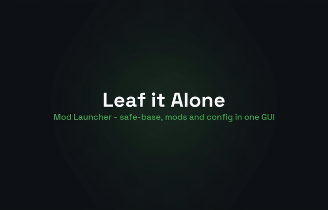

# Leaf it Alone Mod Launcher

A single GUI app that manages Leaf it Alone mods and the safe-base so users never
have to run the per-mod PowerShell scripts or edit JSON by hand.

**The launcher is an orchestrator, not a rewrite.** It drives the already-tested
engines as hidden subprocesses — `safe-base/install.ps1`, `uninstall.ps1`,
`uninstall-all.ps1`, `status.ps1`, and each mod's `apply.ps1`/`revert.ps1` (which
run the UnityPy patchers). No firewall / Steam-proxy / save-isolation / patch logic
is duplicated in C#, so the safety guarantees built in milestones M1–M7 hold
unchanged.

> This is the primary path going forward. The manual scripts still work and are
> documented in `safe-base/README.md` as the advanced / manual appendix.

## Showcase



*23-second walkthrough — Dashboard (Play-first) → the manifest-driven Mods editor →
the live Light/Dark + accent swap.* The preview above is a GIF because that is the only
animated format GitHub renders inline in a README. For the full-quality clip, open
[`media/launcher-showcase.mp4`](media/launcher-showcase.mp4) — GitHub plays MP4 files on
the file page.

## Status

Milestones **L1–L9** are complete, including **L8** (distribution polish — the
first-run walkthrough, troubleshooting map, release-zip layout and credits below).

> **L9** is the visual overhaul + functional settings: a live Light/Dark theme with an
> accent picker, a left nav rail (Dashboard / Mods / Settings), and a Settings page that
> actually works — theme/accent applied live and persisted, plus content-root and
> game-exe path overrides. All hand-built WPF styles (no theme packages, so the offline
> build constraint holds). See the "Look & settings (L9)" section below.

**L1** — WPF app that builds and runs; the subprocess `ProcessRunner` (PowerShell
`-File`, `ArgumentList` quoting, streamed Output log, timeout + exit code); mod
discovery from `content-mods/<id>/mod.json`; the manifest schema; `bag-capacity`
refactored to ship one; a read-only mod list.

**L2** — the **schema-driven editor**: selecting a mod renders one control per
manifest field by declared `type` (slider+box for int/float, checkbox for bool,
combo for enum, text box for text), with `when`-gated visibility (e.g. the bag
sizes only show in `mode: sizes`). For numeric fields the **slider and the text
box are decoupled**: the slider stays bound to the manifest's safe `min`/`max`
band, while the box accepts any value except 0 (it rejects blank/non-numeric/zero
and snaps back), so users can push a value past the slider's range on purpose — the
slider then just pins to the nearest bound and the saved JSON keeps the real number.
Edits write the live
`%LOCALAPPDATA%\LeafItAloneSafe\<id>.json`, **preserving every key the schema does
not mention** (`_comment`, `_applyHelper`, …). The enable toggle and applied-config
SHA persist to `launcher/state.json`.

**L3** — **apply/revert orchestration**: the Mods detail pane has **Apply / Revert**
buttons that drive the real `apply.ps1` / `revert.ps1` through `ApplyOrchestrator` +
`ProcessRunner` (never reimplementing patching). `-Python` is resolved by
`PythonLocator` (bundled → `LEAF_PYTHON` → system) and passed to apply only. Cheap
preconditions (game running / safe-base / Python) are mirrored for a friendly early
message while the scripts stay authoritative. On a clean exit the applied SHA +
version are recorded and the badge clears. The Output log **auto-scrolls** to new
lines (following only when you're already at the bottom).

**L4** — **Apply & Launch**: the Dashboard action reconciles every mod against its
enable toggle in manifest `order` (apply what should be live, revert what was switched
off, skip what's in sync), then starts the game from the path safe-base recorded in
`manifest.json` (`GameLauncher`). Any blocked/failed mod stops the sequence **before**
launch, so the game never boots half-modded.

**L5** — **safe-base lifecycle + first-run landing**: the Dashboard (now the default
tab) shows the framework's state from `manifest.json` and drives its install/teardown
through `SafeBaseService` → the real `install.ps1` / `uninstall-all.ps1` / `status.ps1`
(subprocess only; self-elevation is handled by the scripts, whose exit code we read).
**Install safe-base** appears when it is missing (first-run guidance), **Uninstall all**
when present, and **Run full status** streams the full report and surfaces its
`VERDICT:` line. Uninstall also clears every mod's applied marker so the badges stay
honest.

**L6** — **overlay slimdown.** The in-game F8 bag editor is retired now that the
launcher owns bag config: `leaf_overlay.cpp` keeps only the banner + one-shot
preflight, the `[bageditor]` ini keys, `apply-on-exit.ps1` and the `_applyHelper`
injection are gone, and `version.dll` is rebuilt. (Lives in `overlay/` +
`safe-base/` + `content-mods/`, not the C# app.)

**L7** — **mod-runtime detection + the second data-only mod.** Instead of bundling a
private Python (no network at build time, and the launcher runs via `dotnet`), the
launcher *detects* the engine runtime: `Services/PythonHealth.cs` probes the resolved
interpreter once (version + whether `UnityPy` imports) with a pure, unit-tested
classifier, the Dashboard shows a **"Mod engine runtime"** status panel, and when no
usable Python 3.12 + UnityPy is found it opens a guided **setup popup** — the pinned
download link, the exact `pip install UnityPy` command and a **Re-check** that re-probes
without a restart. `ApplyOrchestrator` gates a Python-requiring apply on that probe.
Part B adds **`more-leaves`** — a second UnityPy mod shipped purely as a `mod.json` +
scripts (no launcher code) that densifies each area's `leavesCount`, proving discovery is
fully manifest-driven. 100 headless checks pass.

**L9** — **visual overhaul + functional settings.** The old per-mod scripts and stub
Settings tab are gone from the UX: the window is now a **left nav rail** (brand mark,
Dashboard / Mods / Settings, busy + pending indicators) over a header band, a page
region, a collapsible dark **console** with a Clear affordance, and a slim status bar.
Each page is its own `UserControl` (`Views/DashboardView`, `Views/ModsView`,
`Views/SettingsView`); the schema-driven Mods editor moved into `ModsView` verbatim, so
its behaviour is unchanged. Theming is entirely hand-written — `Theme/Light.xaml` and
`Theme/Dark.xaml` define one shared set of **semantic brushes**, `Theme/Controls.xaml`
supplies every control `Style`/`ControlTemplate` (rounded buttons, restyled slider /
textbox / checkbox / combo / list / scrollbar, the nav item style) and references those
brushes through `DynamicResource`. `ThemeManager` swaps the merged dictionary and
re-derives the accent at runtime, so **Light/Dark and the accent (presets + custom hex)
change live with no restart**; the console stays dark in both themes so log lines stay
legible. `Services/AppConfig.cs` persists `theme`/`accent`/`contentRootOverride`/
`gameExeOverride` to `launcher/settings.json` beside `state.json` (fail-safe load,
normalising bad values). The Settings page wires that up: theme + accent pickers apply
and save on click, a **content-root override** re-scan (`Rescan()` → `TryLocate(start)`)
and a **game-exe override** feed the existing launch seam (`GameLauncher.Launch(exeOverride)`
— override wins only if the file exists, else the safe-base manifest path). Path pickers
use the in-box .NET 8 `OpenFolderDialog` / `OpenFileDialog` and are raised from the VM as
events, opened in the code-behind (dialogs stay out of the VM, as with the Python popup).
Five L9 headless checks cover the `AppConfig` round-trip, override-aware discovery,
game-exe override resolution, the accent lighten/darken/on-accent math and Light↔Dark
token parity; the full suite passes.

**L8** — **distribution polish.** The launcher is promoted to the primary path in the
top-level README, and this file gains a first-run walkthrough, a troubleshooting map
(where `state.json` / `settings.json` / `manifest.json` and the engine + overlay logs
live), a concrete **self-contained release-zip layout** and honest credits/licensing.
`um publish check` is clean across the content mods and the launcher. Releasing is still
the user's call — nothing is published from here.


## Layout

```
launcher/
  LeafItAloneLauncher.sln      one solution, one project
  global.json                  pins the .NET 8 SDK so it builds offline against the
                               locally installed 8.0 targeting packs
  src/Launcher/                the WPF app
    App.xaml / MainWindow.xaml
    ThemeManager.cs            live theme/accent swap (merged-dictionary + derived brushes)
    Theme/                     Light.xaml, Dark.xaml (semantic brushes) + Controls.xaml (styles)
    Views/                     DashboardView / ModsView / SettingsView (UserControls),
                               PythonSetupWindow, converters
    Models/                    ModManifest (+ ConfigField), ModInfo
    Services/                  RepoLocator, ProcessRunner, ModDiscovery, EnvPaths,
                               GameLauncher, SafeBaseService, PythonHealth, AppConfig
    ViewModels/                MainViewModel + ObservableObject + RelayCommand + Section
  tests/HeadlessChecks/        a console harness (no game, no UI) for L1–L9 checks
```

## Build & run (dev)

Requires the **.NET 8 SDK** (`winget install Microsoft.DotNet.SDK.8`, or via
Visual Studio 2022 17.9+). `global.json` pins the launcher to that SDK.

```powershell
cd launcher
dotnet build LeafItAloneLauncher.sln -c Debug        # compiles the app
dotnet run --project src/Launcher                   # launches the WPF window
```

The app locates the content root by walking up from the executable until it finds a
folder with both `content-mods/` and (`safe-base/` for the repo, or `tools/` for a
published layout). From a dev build that resolves to the repo root, so the Mods tab
shows `bag-capacity` straight from `content-mods/bag-capacity/mod.json`.

### Headless checks (fast, no window)

```powershell
cd launcher
dotnet run --project tests/HeadlessChecks
```

Asserts discovery, the manifest round-trip, `%LOCALAPPDATA%` path expansion and the
subprocess runner (exit code + streamed output). Exits non-zero on any failure, so
it can gate the build.

## Look & settings (L9)

The UI is a **left nav rail** with three pages — **Dashboard** (Play first, then safe-base,
mod engine runtime, tools), **Mods** (the schema-driven editor list + detail) and
**Settings**. A collapsible dark console shows the streamed engine output; a status bar
sits at the bottom.

**Settings is functional:**

- **Theme** — Light / Dark / System, plus an **accent** picker (green, teal, blue,
  violet presets or a custom `#RRGGBB`). Every change applies **live** (no restart) and
  persists to `launcher/settings.json`. `System` follows the OS app theme.
- **Content root override** — point the launcher at a different `content-mods/` tree.
  Browse (folder picker) or clear back to auto-detect; on change it re-scans and the
  Mods page follows the new root. The resolved path is shown read-only.
- **Game exe override** — launch a specific executable instead of the path safe-base
  recorded. Browse (`*.exe`) or clear; an override only wins if the file exists,
  otherwise it falls back to the manifest path.
- **Reset to defaults** restores theme, accent and both overrides.

Look is 100% hand-written WPF (no theme packages). If you add a control style, reference
the semantic brushes by `DynamicResource` (never a hard-coded colour) so it re-themes on
a swap; keep the console dark in both palettes.

## Using it (first run)

No prerequisites to read up on — the app tells you what it needs, in order. Open the
launcher and work top-to-bottom on the **Dashboard** (it leads with **Play**):

1. **Install the safe-base** — if it's missing, the Dashboard shows an *Install
   safe-base* button. One click, one UAC prompt (the scripts self-elevate; the launcher
   never reimplements the firewall / Steam-proxy / save-isolation). When it's in place
   the button flips to *Uninstall all* and you can *Run full status*.
2. **Set up the mod engine (one time)** — mods that patch bundles need Python 3.12 +
   UnityPy. The Dashboard's *Mod engine runtime* panel probes for it; if it's absent a
   guided popup opens with the pinned download link, the exact
   `pip install UnityPy` command and a **Re-check** that re-probes without a restart.
   Nothing is bundled and no logic runs until Python is healthy.
3. **Tune mods** — the **Mods** page lists every discovered mod (read straight from
   each `content-mods/<id>/mod.json`); selecting one renders its config editor. Toggle a
   mod on/off and edit values; the badge marks *pending* until applied.
4. **Play** — **Apply & Launch** reconciles every mod (applies what should be live,
   reverts what you switched off, skips what's in sync) and then starts the game. A
   blocked or failed mod stops the sequence **before** launch, so you never boot
   half-modded. Watch the collapsible **Output** console for the engines' live logs.

Everything else (theme/accent, content-root and game-exe overrides) lives in
**Settings** and applies live.

## Troubleshooting

The launcher keeps its own bookkeeping and the safe-base keeps its state under
`%LOCALAPPDATA%\LeafItAloneSafe\` — none of it touches your real save unless a mod is
applied, and uninstall restores everything:

| Where… | Path |
|---|---|
| Launcher state (enabled toggles + last-applied config hash) | `%LOCALAPPDATA%\LeafItAloneSafe\launcher\state.json` |
| Launcher appearance + path overrides (theme/accent/content-root/game-exe) | `%LOCALAPPDATA%\LeafItAloneSafe\launcher\settings.json` |
| Per-mod live config (the values `apply.ps1` reads) | `%LOCALAPPDATA%\LeafItAloneSafe\<mod-id>.json` |
| safe-base manifest (game path, proxy + backup hashes) | `%LOCALAPPDATA%\LeafItAloneSafe\manifest.json` |
| Original files safe-base backed up (real `steam_api64.dll`, your `Saves/`) | `%LOCALAPPDATA%\LeafItAloneSafe\backup\` |

- **The game won't launch from the launcher** — check the safe-base installed a game
  path (see `manifest.json`), or set a **Game exe override** in Settings.
- **"Mod engine runtime" says not found** — follow the setup popup's link +
  `pip install UnityPy`, then **Re-check**; you can also point `LEAF_PYTHON` at a
  specific interpreter.
- **A mod failed to apply** — read the **Output** console (the engine's own error is
  streamed there, colour-coded); every apply backs up before writing and auto-restores
  on failure, so the game is left in its last good state.
- **The in-game banner is red** — a safe-base precondition failed mid-session; run
  *Run full status*. The overlay's own log is `LeafOverlay.log` beside the game exe; the
  game's Unity log is at `%USERPROFILE%\AppData\LocalLow\Eternity\Leaf it Alone\`.
- **Back out of everything** — *Uninstall all* reverts every registered mod, restores
  your original save, then removes the firewall rule last. The manual equivalent is
  `safe-base/uninstall-all.ps1`.

## Publish (self-contained, for users)


Ships as one folder/zip the user can run with **no .NET install**:

```powershell
cd launcher
dotnet publish src/Launcher/Launcher.csproj -c Release -r win-x64 --self-contained -p:PublishSingleFile=true -o publish
```

> **Offline caveat:** `--self-contained` needs the `Microsoft.*(App.)Runtime.win-x64`
> and `Microsoft.NET.ILLink.Tasks` NuGet packages, which are downloaded on first
> publish. On a machine **with internet** this just works; a build environment
> without those packs (or network) can only do the framework-dependent publish
> (`dotnet publish -c Release`), which is what CI here validates. The published
> `publish/` folder then needs the `content-mods/` and engine scripts beside it (see
> the packaging milestone, L7).

**Release-zip layout** (what goes beside the self-contained exe so `RepoLocator` finds a
published root — a `content-mods/` tree next to a `tools/` engine folder):

```
LeafItAloneLauncher.zip
└── LeafItAloneLauncher/
    ├── LeafItAloneLauncher.exe   (self-contained; + any *.dll the publish drops)
    ├── content-mods/             every mod: <id>/mod.json + apply.ps1/revert.ps1 + <patch>.py
    └── tools/                    the safe-base engines the launcher shells out to
        ├── install.ps1  uninstall.ps1  uninstall-all.ps1  status.ps1
        ├── common.ps1   base.psm1
        └── steam_proxy/steam_api64.dll   (first-party stub proxy, not a game file)
```

Zip that folder and attach it to a GitHub Release; users unzip anywhere and run the exe
(no .NET install). **Do not include** `bin/`, `obj/`, `publish/` intermediates, the
`_re_scratch/` scratch dir, `mod-backups/`, or any game file — the `um publish check`
lint above is the guard against exactly that.


## `mod.json` manifest schema

A mod is fully described by `content-mods/<id>/mod.json`. The launcher builds its
mod list and config editors purely from these files — **adding a mod never means
writing app UI code.** Top-level keys:

| Key          | Meaning |
|--------------|---------|
| `id`         | stable folder id (defaults to the folder name) |
| `name`       | display name |
| `version`    | mod version |
| `description`| shown in the Mods detail pane |
| `homepage`   | optional link / credits |
| `order`      | apply order (lowest first) |
| `configPath` | the live value store, e.g. `%LOCALAPPDATA%\LeafItAloneSafe\bag-capacity.json` (`%VAR%` tokens expand at runtime) |
| `config`     | `{ "fields": [...] }` — the editor schema (below) |
| `apply`      | `{ "script": "apply.ps1", "args": ["-Yes"] }` — run via the subprocess runner |
| `revert`     | `{ "script": "revert.ps1", "args": ["-Yes"] }` |
| `requires`   | `{ "safeBase": true, "gameNotRunning": true, "python": true }` |

Each entry in `config.fields` describes one editable value:

| Key       | Meaning |
|-----------|---------|
| `key`     | dotted path into the live JSON (`multiplier`, `sizes.small`) |
| `label`   | UI label |
| `type`    | `int` \| `float` \| `bool` \| `enum` \| `text` |
| `min`/`max`/`step` | numeric bounds (int/float) |
| `default` | fallback when the live config lacks the key |
| `help`    | tooltip |
| `options` | allowed values (`type: enum`) |
| `when`    | `{ "key": "...", "equals": ... }` conditional visibility |

The manifest only *describes* the config file; `apply.ps1` remains the source of
truth for reading it, and the launcher preserves any keys the schema does not
mention (`_comment`, `_applyHelper`, …). `content-mods/bag-capacity/mod.json` is the
reference implementation and `content-mods/more-leaves/mod.json` is the second — added
with **no launcher code**, which is the point of the manifest-driven design.

## Credits & license

- **Built with AI assistance** (the Claude coding agent), with every in-game result
  verified by hand on the user's own machine before merge.
- **Runtime:** .NET 8 / WPF (in-box, MIT-licensed) — the launcher pulls **no NuGet
  packages**, so it builds offline against the installed targeting packs.
- **Engine it drives:** [UnityPy](https://github.com/Logardas/UnityPy) (MIT) for the
  AssetBundle patchers, invoked through the repo's own tested PowerShell scripts — the
  launcher is an orchestrator, not a re-implementation of the safety layer.
- **Overlay technique:** the native `version.dll` / `steam_api64.dll` proxies are
  first-party Win32 builds in this repo (their `.cpp`/`.def` and MSVC intermediates ship
  beside them); they are **not** game files, and none are redistributed.
- **Lint:** `um` (universal-modder) `publish check` runs clean across the mods + launcher.
- **License:** MIT for everything here. You must own *Leaf it Alone* to run any of it.
  **No game files or extracted game assets are redistributed.**

