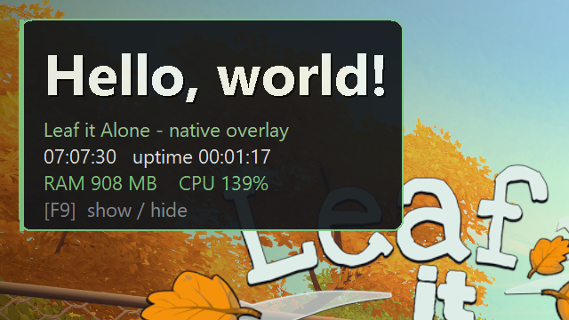

# Leaf it Alone — Native Overlay (example mod)

A minimal, self-contained **native overlay mod** for [*Leaf it Alone*](https://store.steampowered.com/app/3981100/)
(Unity 6000.5.6f1, IL2CPP). It draws a small, configurable HUD on top of the game —
"Hello, world!", a live clock, **live in-game runtime metrics (the game's RAM & CPU%)**, and a
show/hide hotkey — **without touching the game's code, memory, or assets**.

It doubles as a **template**: if you want to build your own overlay-style mod for this
game, start here.



**Showcase clip** (21 s) — the HUD on the main menu, the F9 show/hide toggle, then loading into
the game and watching the live **RAM** value jump (~880 MB → ~1230 MB) as the level loads.
Recorded straight off the running game.


---

## Why a *native* overlay (and not BepInEx / MelonLoader)

This build of *Leaf it Alone* is **protected**:

- `global-metadata.dat` is **encrypted** on disk and is never fully plaintext in memory.
- All **263 exports of `GameAssembly.dll` are renamed** to random strings and wrapped in
  **virtualized dispatchers**.

Because of that, the usual Unity-IL2CPP loaders (BepInEx 6, MelonLoader 0.7.3/0.7.4-ci)
*bootstrap* but never finish initializing the managed runtime — so C# mods that hook
`UnityEngine`/game types can't load. We confirmed this directly on the shipped build.

For a **cosmetic on-screen overlay** you don't need the managed runtime at all. This mod
sidesteps the entire IL2CPP layer:

> It injects a tiny native DLL, finds the game's window, and paints a topmost, click-through
> layered window over it. It works no matter which graphics API the game uses (D3D11 here).

**Trade-off:** this is an *overlay*, not a general modding API. It reads **real live values from
the game process itself** (RAM working set + CPU%), but it can't (yet) read or change *managed
gameplay state* (player position, in-game timers) — that path is blocked by the IL2CPP protection.
See "Ideas to extend" below.

---

## Requirements

- Windows x64, *Leaf it Alone* installed (Steam).
- The game runs in **borderless / windowed** mode. It ships as `FullScreenWindow`
  (Unity `displayMode = 1`) by default, which this overlay composites over correctly.
  If you switch the game to **Exclusive Fullscreen**, a topmost window won't show — use
  borderless/windowed.
- To **build from source**: any Visual Studio 2022+ with the "Desktop development with C++"
  workload (uses `cl.exe`). No other dependencies.

---

## Install

From this folder (`overlay/`):

```powershell
# 1) build the DLL (produces version.dll)
powershell -ExecutionPolicy Bypass -File build_overlay.ps1

# 2) install into the game (auto-detects the Steam folder; backs up any existing loader)
powershell -ExecutionPolicy Bypass -File install_overlay.ps1
```

Then launch the game via Steam. You'll see the HUD in the top-left; press **F9** to toggle.

> The installer locates the game by scanning your Steam libraries. If it can't find it,
> pass the folder explicitly:
> `install_overlay.ps1 -Game "D:\SteamLibrary\steamapps\common\Leaf it Alone"`

### What install does
- Moves any existing `version.dll` / `MelonLoader` / `winmm.dll` in the game folder to a
  timestamped backup folder (nothing is deleted).
- Copies in our `version.dll` and a default `LeafOverlay.ini`.

## Uninstall

```powershell
powershell -ExecutionPolicy Bypass -File uninstall_overlay.ps1
```

Removes the overlay files and restores the backup, returning the game folder to its
pre-mod state.

---

## Configuration

Everything is in `LeafOverlay.ini` (next to `version.dll` in the game folder). Edit it and
relaunch — **no recompiling**. Every key is optional (defaults shown):

| Key | Default | Meaning |
|-----|---------|---------|
| `ToggleKey` | `F9` | Show/hide hotkey. `F1`–`F24`, a single letter/digit, or `INSERT`/`HOME`/`END`/`SPACE`/`TAB`. |
| `Corner` | `TopLeft` | Panel anchor: `TopLeft`, `TopRight`, `BottomLeft`, `BottomRight`. |
| `Margin` | `22` | Pixels from the anchored corner. |
| `Alpha` | `235` | Panel opacity `1`–`255` (255 = solid). |
| `ShowTitle` | `true` | Show the big title line. |
| `ShowClock` | `true` | Show the live clock (`HH:MM:SS`). |
| `ShowUptime` | `true` | Show session uptime (`HH:MM:SS`). |
| `ShowMetrics` | `true` | Show live in-game runtime values: the game process's RAM (MB) and CPU%. |
| `Title` | `Hello, world!` | Big line text. |
| `Subtitle` | `Leaf it Alone - native overlay` | Small green line text. |

### `[safebase]` section (M4)

The same DLL doubles as safe-base's in-game reporter. When
`[safebase] Enabled=true`, the overlay switches to a **minimal banner-only
mode**: the HUD panel (title / clock / uptime / metrics) is **not drawn at
all** and the show/hide hotkey is ignored. Instead a **persistent plain-text
line** is drawn at the top-centre of the screen — no box, no backdrop, just
text with a thin black outline so it stays readable over any scene —
reading `OFFLINE · MODDED PLAY · SCORES WILL NOT BE SUBMITTED`. It is never
hideable, so you can always see at a glance that the safety layers are
active, without it distracting during play. Alongside the banner, the DLL
runs a **one-shot preflight** at game startup from inside the game process:

- file-size check on the Steam proxy at `<game folder>\Leaf it Alone_Data\Plugins\x86_64\steam_api64.dll`,
- existence check on the Saves/ isolation marker at
  `%USERPROFILE%\AppData\LocalLow\Eternity\Leaf it Alone\Saves\.safebase-empty`,
- live non-blocking `connect(1.1.1.1:443)` with a short timeout — the only
  way to prove the program-scoped firewall rule is actually enforcing, since
  the rule keys off the *game's* PID (PowerShell scripts testing connectivity
  would test their own process, not the game's).

If any check fails, the banner text turns **red** and shows a compact
reason; full details go to `LeafOverlay.log`. Safe-base does not police the
game after this — if you turn the firewall rule off mid-session the banner
stays as it was drawn at startup, because we deliberately do not add a
trip-wire.

| Key | Default | Meaning |
|-----|---------|---------|
| `Enabled` | `false` | Turn the whole M4 layer on. Off by default so standalone HUD users see no change. **On, the HUD panel is suppressed entirely** (banner-only mode). |
| `Banner` | `true` | Draw the banner. When false, the preflight still runs (and logs) but nothing is drawn — the screen is completely clean. |
| `BannerCorner` | `TopCenter` | `TopCenter`, `TopLeft`, `TopRight`, `BottomCenter`. |
| `BannerMargin` | `14` | Pixels from the anchor edge. |
| `BannerText` | (empty) | Optional override of the banner string. Empty uses the built-in default. INI encoding is ANSI; non-ASCII needs the file saved as UTF-16 LE. |
| `CheckSteamProxy` | `true` | Verify steam_api64.dll exists (and matches size if `ExpectedSteamProxySize` non-zero). |
| `CheckSaveIsolation` | `true` | Verify the `.safebase-empty` marker is in place. |
| `CheckOutbound` | `true` | Run the live `connect(1.1.1.1:443)` probe. |
| `ExpectedSteamProxySize` | `0` | Bytes. `install.ps1` fills this in from the proxy size it just placed. `0` disables size comparison. |
| `ProbeTimeoutMs` | `1500` | Cap on the outbound probe, clamped `100`–`5000`. |

---

## How it works

```
Leaf it Alone.exe
  └─ UnityPlayer.dll  ──(imports)──►  version.dll   ← OURS (proxy)
                                          │
                                          ├─ forwards the 6 version.* APIs to the real
                                          │  %WINDIR%\System32\version.dll  (transparent)
                                          └─ DllMain → CreateThread
                                                └─ find the game's render window
                                                   (largest visible top-level window in our PID,
                                                    excluding our own overlay)
                                                   └─ create a topmost, click-through,
                                                      color-keyed layered window the same size,
                                                      and paint the HUD on a 50 ms timer.
```

Key points:

- **Injection via DLL search-order hijack.** `UnityPlayer.dll` imports `version.dll`, which
  resolves to our copy in the game folder. On x64 we only need to forward the **6** version
  functions it actually imports (see `version.def`), so nothing else breaks.
- **Rendering.** A `WS_EX_LAYERED | WS_EX_TRANSPARENT | WS_EX_TOPMOST | WS_EX_NOACTIVATE`
  popup sized to the game window. `SetLayeredWindowAttributes(colorKey, alpha)` makes the
  background fully transparent and the panel translucent. GDI draws the panel + text.
- **No game coupling.** It never reads game memory or the encrypted metadata, so it's immune
  to the IL2CPP protection and safe against the game's single-player/offline nature.
- **Live metrics without touching the game.** Because our DLL is loaded *inside* the game
  process, `GetCurrentProcess()` *is* the game. The HUD's `RAM`/`CPU%` come from ordinary
  read-only OS APIs — `K32GetProcessMemoryInfo` (working set) and `GetProcessTimes` (CPU time
  delta over a wall-clock window) — resampled once per second. Real, live, and no memory poking.

### Files

| File | Purpose |
|------|---------|
| `leaf_overlay.cpp` | The whole mod (~1 source file). |
| `version.def` | Exports the 6 public `version.dll` names (mapped to internal `ov_*` impls). |
| `build_overlay.ps1` | Imports the MSVC x64 environment and compiles `version.dll`. |
| `install_overlay.ps1` / `uninstall_overlay.ps1` | Reversible install/restore. |
| `LeafOverlay.ini` | Default configuration (copied into the game on install). |

---

## Build your own mod from this template

The overlay content lives in `PaintOverlay()` in `leaf_overlay.cpp`. To customize:

- **Change the look**: panel colors are the `RGB(...)` calls near the `RoundRect` / text code.
- **Add a line**: append another `rows[n++] = { L"my text", RGB(...) };` and it's measured/laid
  out automatically.
- **Reposition**: `Corner` + `Margin` already cover the four corners; add more in `LoadConfig()`.
- **React to a key**: the F9 edge-detection in `WndProc` (`WM_TIMER`) is the pattern — poll
  `GetAsyncKeyState(vk)` for focus-free hotkeys.

Rebuild with `build_overlay.ps1`, re-run `install_overlay.ps1`, relaunch.

### Ideas to extend (harder)
- **Show *managed* gameplay data** (e.g. player position, an in-game timer): the by-name IL2CPP
  lookup is blocked by the protection — there is no dumpable decrypted metadata, and only a few
  stable functions (`il2cpp_runtime_invoke`, `il2cpp_image_get_class`, …) were recovered by
  signature. Getting a `MethodInfo*` to invoke a getter would need resolving
  the domain + by-name chain at runtime against the virtualized 85 MB binary — significantly more
  fragile. This mod sidesteps that and instead shows **real process metrics** (RAM/CPU), which are
  live and safe. Add your own line in `UpdateMetrics()`/`PaintOverlay()`.
- **In-scene rendering** (draw with the game's own D3D11 device): hook `IDXGISwapChain::Present`
  from a `dxgi.dll`/`d3d11.dll` proxy instead of a separate window. More integrated, more fragile.

---

## Safety & legality

- *Leaf it Alone* is **single-player / offline** with **no anti-cheat**. This mod does not
  bypass DRM, does not touch online services, and does not read/modify game files — it only
  draws a window on top.
- **No game assets are shipped.** This is "bring your own game": the mod is just `version.dll`
  + an `.ini` that runs against *your* install.
- Keep it to single-player/offline use.

## Troubleshooting

| Symptom | Fix |
|---------|-----|
| No overlay, but game runs | Make sure the game is **borderless/windowed**, not Exclusive Fullscreen. |
| Overlay on the wrong screen | It follows the game window automatically; if the game moves monitors it re-attaches within ~200 ms. |
| Want to confirm it injected | Open `LeafOverlay.log` in the game folder — it logs config + window attach + toggles. |
| Game won't start after install | Run `uninstall_overlay.ps1` to restore your previous `version.dll`/MelonLoader. |

## Credits & disclosure

- Built with AI assistance (Claude) as a demonstration of reverse-engineering a protected Unity
  IL2CPP build and choosing a safe native-overlay route.
- Uses only the Win32/GDI APIs. No third-party code is bundled.

## License

MIT (see `LICENSE.md`). Do whatever you like with the mod code; you must own the game to run it.
